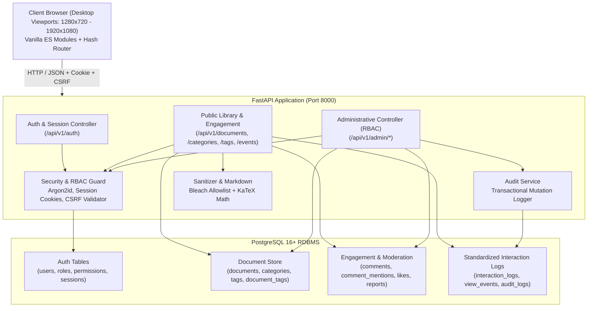
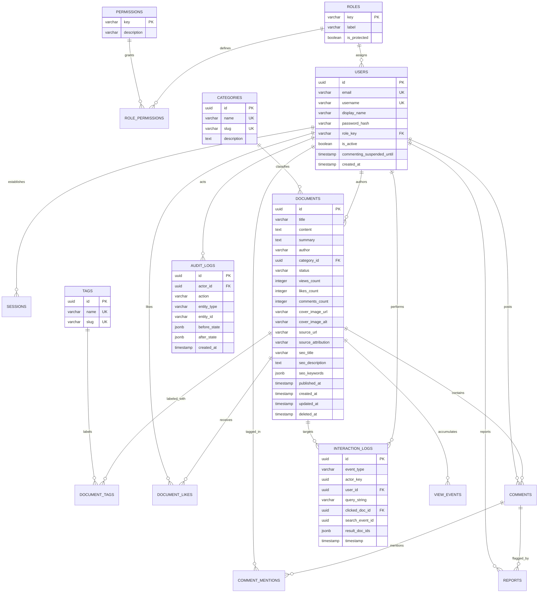

# Folio — Architecture & System Design Specification

This document provides a comprehensive technical reference for the architecture of **Folio — Knowledge & Research Library**, an enterprise research document repository built to satisfy Phase 1 full-stack requirements and establish the foundation for Phase 2 information retrieval algorithms.

---

## 1. System Topology & Architecture Overview

Folio adopts a modular, tiered architecture separating persistent storage, core domain services, RESTful API presentation, and a native ES-module frontend.

---

## 2. Relational Entity-Relationship Diagram (ERD)

The database schema is managed via Alembic migrations on PostgreSQL 16+.

---

## 3. Roles and Permissions Matrix (RBAC)

Folio uses a fine-grained, database-driven capability permission system. Application endpoints enforce capabilities (e.g., `documents:write`, `moderation:manage`) rather than role string checks.

| Capability Permission | member | content_manager | moderator | data_seo | super_admin |
| :--- | :---: | :---: | :---: | :---: | :---: |
| `documents:write` | - | **Yes** | - | - | **Yes** |
| `taxonomy:write` | - | **Yes** | - | - | **Yes** |
| `moderation:manage` | - | - | **Yes** | - | **Yes** |
| `seo:write` | - | - | - | **Yes** | **Yes** |
| `analytics:read` | - | - | - | **Yes** | **Yes** |
| `users:manage` | - | - | - | - | **Yes** |
| `roles:manage` | - | - | - | - | **Yes** |
| `audit:read` | - | - | - | - | **Yes** |
| `settings:write` | - | - | - | - | **Yes** |

### Last Super Administrator Protection Invariant
To prevent administrative lockout:
- Any modification to user status (`is_active = false`) or role (`role_key != 'super_admin'`) executes an explicit row-locked SQL query (`SELECT ... FOR UPDATE`) checking the count of active super administrators.
- If the target user is the final remaining active `super_admin`, the request is rejected with HTTP `409 Conflict` and transaction rolled back.
- The `super_admin` role's capabilities cannot be modified or revoked in the Permissions Matrix.

---

## 4. Phase 2 Document Store & Standardized Interaction Logging

### Document Schema Mapping
The `documents` table fulfills all Phase 2 storage requirements:
- `id` (UUID): Primary key.
- `title` (VARCHAR 500): Article title.
- `content` (TEXT): Raw Markdown/HTML research text.
- `summary` (TEXT): Abstract / teaser.
- `category_id` (UUID FK): Many-to-one relationship to `categories`.
- `tags`: Many-to-many relationship joined via `document_tags`. Public API serializes tags as `[{id, name, slug}, ...]`.
- `author` (VARCHAR 255): Attribution / scholar name.
- `created_at` (TIMESTAMP UTC): System creation timestamp.
- `views_count` (INTEGER): Cached counter updated via idempotent `POST /documents/{id}/views`.

### Search & Click Interaction Logging Semantics
Folio implements a two-event click-through tracking pipeline designed for evaluation and ranking training:

1. **Search Request Event:**
   - Triggered when a client queries `GET /api/v1/documents?q=<term>`.
   - Generates a record in `interaction_logs` with `event_type = 'search'`, `query_string = <term>`, `result_doc_ids = [<uuid>, ...]`, and assigns a unique `search_event_id`.
   - If user is anonymous, `user_id` is recorded as `NULL`, but `actor_key` (opaque browser session UUID) is persisted.
   - Searching without a keyword (e.g. browsing a category) returns `search_event_id = null` and logs no search query event.

2. **Result Click Event:**
   - Triggered when a user clicks a search result card (`POST /api/v1/events/clicks`).
   - The payload provides `{search_event_id, document_id, request_key}`.
   - The backend validates:
     - The referenced `search_event_id` exists and belongs to the same `actor_key`.
     - The target `document_id` was actually present in `result_doc_ids` of that search.
     - The target document is currently published and not deleted.
   - A separate record is inserted into `interaction_logs` with `event_type = 'click'`, copying `query_string` server-side from the parent search event, recording `clicked_doc_id`, `search_event_id`, and `user_id`.
   - **Idempotency Guarantee:** Retrying with the same `request_key` UUID returns the existing click ID without double-counting clicks.

---

## 5. Security & Authentication Architecture

1. **Password Hashing:**
   - Implemented using Argon2id with salt generation via `argon2-cffi`. Plaintext passwords are never stored or logged.

2. **Session Lifecycle:**
   - Cookie-based session token (`folio_session`) generated using `secrets.token_urlsafe(32)` (256-bit entropy).
   - Marked `HttpOnly`, `SameSite=Lax`, `Path=/`.
   - Only the SHA-256 hash of the session token is stored in the database.
   - On authentication (login/register/logout/password change), session tokens are rotated to prevent session fixation.

3. **CSRF Protection:**
   - Every state-changing HTTP method (`POST`, `PUT`, `PATCH`, `DELETE`) enforces a valid `X-CSRF-Token` header.
   - The CSRF token is issued in session context (`GET /api/v1/auth/session`), bound to the active session ID, and verified cryptographically on every mutation.

4. **Sanitization:**
   - Public user content (comments, bios) and research content are sanitized using `bleach` with a strict allowlist (`p`, `h1`-`h6`, `pre`, `code`, `blockquote`, `ul`, `ol`, `li`, `a`, `img`, `strong`, `em`).
   - All external hyperlinks enforce `rel="noopener noreferrer"`.
   - Raw JavaScript tags (`<script>`), event handlers (`onload`, `onerror`), and `javascript:` URIs are stripped.
