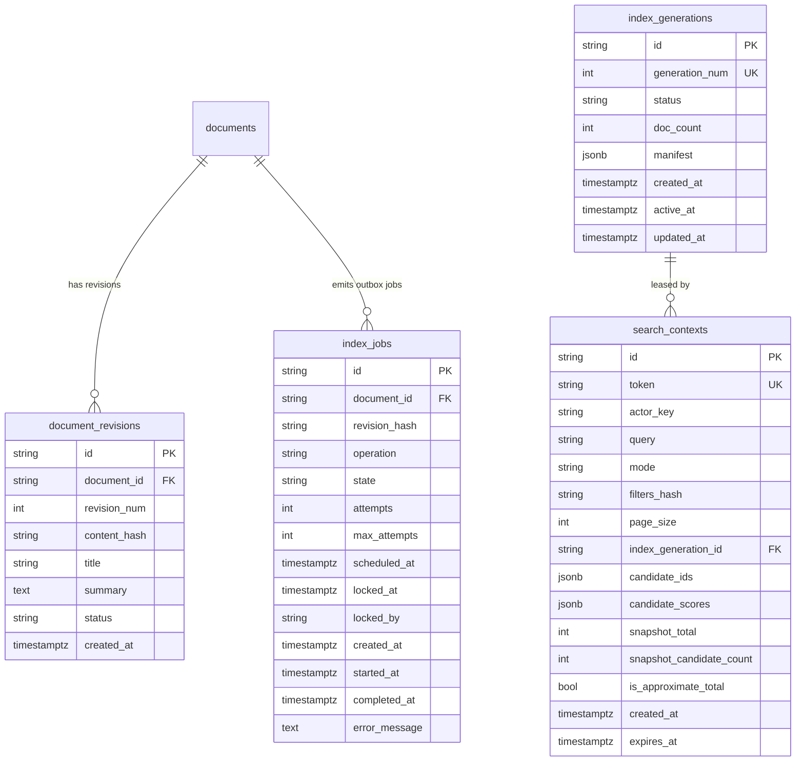

# P03 — Document Import, Index Schema và Lifecycle Worker Handoff

**Ngày:** 01/11/2026 (Asia/Saigon)  
**Vai trò:** Data/Index Platform Engineer (P03)  
**Baseline tích hợp:** `8ecac3d77095d354bca0b064ba01d341d3bc72cc` (Approved Integration A Remediation R03 / R06)  
**Branch:** `feature/p03-index-lifecycle`  
**Alembic Head:** `20261101_index_lifecycle (head)` -> `down_revision = '20261101_rate_limit'`  
**Environment:** Python 3.10.11 (`F:/dpl13.10/folio-live-runtime/venv-clean`), PostgreSQL 16.10 portable (`127.0.0.1:55463`)  

---

## 1. Tổng quan & Kết quả chính

Mốc P03 đã hoàn thành toàn diện hạ tầng Index Lifecycle cho Folio theo đúng `GEMINI-EXECUTION-PROMPTS.md` và `docs/search-contract.md` (v2.1.0), đảm bảo **PostgreSQL là Source of Truth duy nhất**:

1. **Corpus Importer & Validator (`src/backend/search_index/importer.py`):**
   - Hỗ trợ cả `.json` và `.jsonl`.
   - Ánh xạ chính xác `source_url -> Folio Document ID` (bảo toàn 103 canonical IDs trong authentic fixture `fixtures/folio/documents.jsonl`).
   - Dry-run mode (`--dry-run`) xuất báo cáo chi tiết về duplicates trong file, conflicts với DB, attribution và license.
   - Hoạt động idempotent và **tuyệt đối không ghi đè user edits** đã lưu trong Folio.

2. **Transactional Outbox & Content Revision (`src/backend/search_index/outbox.py`, `models/search_index.py`):**
   - Tạo `document_revisions` (lưu snapshot nội dung và SHA-256 hash) và `index_jobs` (lưu `document_id`, `revision_hash`, `operation`, `state`, `attempts`, `scheduled_at`, `locked_at`, `error_message`).
   - Enqueue outbox job trong **cùng transaction** với các thao tác `create`, `update`, `publish`, `unpublish`, `soft_delete`, `seo_update`, và các thay đổi taxonomy (`category`, `tag`) ảnh hưởng đến search.

3. **Index Generation Lifecycle & Atomic Swap (`src/backend/search_index/manager.py`, `storage.py`):**
   - Quản lý các thế hệ index độc lập (`idx-gen-YYYYMMDDHHMMSS-NNNN`).
   - Rebuild thế hệ mới gồm: snapshot published documents -> catch-up các outbox mutations phát sinh trong thời gian build -> verify tính toàn vẹn (checksum + DB published count) -> **atomic swap** sang `active`. Thế hệ cũ chuyển sang `draining`.
   - Nếu rebuild hoặc verify lỗi: giữ nguyên generation cũ đang `active`; không làm gián đoạn hệ thống.
   - Quản lý retention lease: không xóa (GC) generation đang draining nếu còn `SearchContext` unexpired tham chiếu tới.

4. **Lifecycle Worker (`src/backend/search_index/worker.py`):**
   - Cơ chế claim jobs an toàn đa tiến trình bằng PostgreSQL row-level locking (`FOR UPDATE SKIP LOCKED`).
   - **Stale-revision protection:** Nếu một job trễ/out-of-order có revision hash khác với hash hiện tại của document trong DB, worker an toàn bỏ qua (skip), không cho phép dữ liệu cũ ghi đè dữ liệu mới.
   - Retry với exponential backoff (`2^(attempts-1) * base_backoff`) và chuyển sang dead-letter queue (`state='failed'`) sau khi vượt quá `max_attempts`.
   - **Crash recovery:** Tự động phát hiện và thu hồi (reclaim) các job bị khóa bởi worker bị crash/timeout.
   - Tuyệt đối không tải heavy model hay ML pipeline trong request path.

5. **Live Defense-in-Depth (`src/backend/search_index/live_guard.py`):**
   - Cung cấp `filter_live_published_ids`: kiểm tra PostgreSQL live state trên read-path.
   - Documents bị unpublish (`status='draft'`) hoặc soft-deleted (`deleted_at IS NOT NULL`) bị loại bỏ **ngay lập tức (0 giây lag)** khỏi response ngay cả khi index background worker đang lag.
   - Tuân thủ chính sách **Prune without backfill** (giữ nguyên cửa sổ rank và thứ tự ứng viên).

6. **CLI Quản trị (`scripts/index_cli.py`, `src/backend/search_index/cli.py`):**
   - `python scripts/index_cli.py import-corpus --input <file> [--dry-run]`
   - `python scripts/index_cli.py build-index [--force] [--verify]`
   - `python scripts/index_cli.py verify-index [--generation <id>]`
   - `python scripts/index_cli.py index-status`

---

## 2. Database Schema & Migration

Migration mới: `alembic/versions/20261101_index_lifecycle.py`  
- **Revision ID:** `20261101_index_lifecycle`  
- **Down Revision:** `20261101_rate_limit` (linear chain duy nhất)



---

## 3. Sequence Diagrams

### 3.1 Transactional Outbox Mutation Flow

```mermaid
sequenceDiagram
    autonumber
    actor Admin as Content Manager / Admin
    participant Service as Content Service
    participant DB as PostgreSQL (documents, revisions, index_jobs)

    Admin->>Service: PUT /api/v1/admin/documents/{id}
    Note over Service,DB: Bắt đầu database transaction
    Service->>DB: UPDATE documents SET title=..., content=..., updated_at=now()
    Service->>Service: Compute SHA-256 content_hash
    Service->>DB: INSERT INTO document_revisions (revision_num, content_hash, ...)
    Service->>DB: INSERT INTO index_jobs (operation='upsert', state='pending', revision_hash=...)
    Service->>DB: INSERT INTO audit_logs (...)
    Service->>DB: COMMIT TRANSACTION
    Note over Service,DB: Giao dịch thành công; không có orphan job
    Service-->>Admin: 200 OK (updated document payload)
```

### 3.2 Atomic Generation Build & Catch-Up Flow

```mermaid
sequenceDiagram
    autonumber
    participant CLI as CLI / Rebuild Trigger
    participant Mgr as GenerationManager
    participant Disk as Physical Storage (manifest.json)
    participant DB as PostgreSQL

    CLI->>Mgr: build_new_generation(force=False)
    Mgr->>DB: INSERT INTO index_generations (id=G2, status='building')
    Mgr->>Disk: GenerationStorage(G2).initialize()
    Note over Mgr: Ghi nhận rebuild_started_at = T0
    Mgr->>DB: SELECT * FROM documents WHERE status='published' AND deleted_at IS NULL
    Mgr->>Disk: Snapshot 100 published documents into G2 manifest
    Note over DB,Disk: Trong lúc build, có mutation phát sinh tại T0.5 (ghi vào index_jobs)
    Mgr->>DB: SELECT * FROM index_jobs WHERE created_at >= T0
    loop Catch-up concurrent writes
        Mgr->>Disk: Apply upsert/delete for mutations since T0
    end
    Mgr->>Mgr: verify_generation(G2): verify checksum & doc_count vs live published DB
    alt Verification fails
        Mgr->>DB: UPDATE index_generations SET status='failed' WHERE id=G2
        Note over Mgr: G1 vẫn giữ active; abort swap
    else Verification succeeds
        Note over Mgr,DB: Bắt đầu Atomic Swap Transaction
        Mgr->>DB: UPDATE index_generations SET status='draining' WHERE id=G1
        Mgr->>DB: UPDATE index_generations SET status='active', active_at=now() WHERE id=G2
        Mgr->>DB: UPDATE index_jobs SET state='completed' WHERE id IN (:caught_up_jobs)
        Mgr->>DB: COMMIT SWAP TRANSACTION
    end
    Mgr-->>CLI: Generation G2 active successfully
```

### 3.3 Worker Claim, Stale-Revision Protection & Retry Flow

```mermaid
sequenceDiagram
    autonumber
    participant W as IndexWorker
    participant DB as PostgreSQL (index_jobs)
    participant Disk as Generation Storage

    W->>DB: UPDATE index_jobs SET state='pending' WHERE state='processing' AND locked_at < now - 300s (Crash Recovery)
    W->>DB: SELECT * FROM index_jobs WHERE state='pending' AND scheduled_at <= now ORDER BY created_at FOR UPDATE SKIP LOCKED LIMIT 10
    DB-->>W: Returns batch of claimed jobs
    W->>DB: UPDATE index_jobs SET state='processing', attempts=attempts+1, locked_at=now()
    loop For each job
        W->>DB: SELECT current content_hash FROM documents WHERE id = job.document_id
        alt job.revision_hash != current document hash (STALE REVISION)
            W->>DB: UPDATE index_jobs SET state='completed', error_message='Skipped stale revision'
            Note over W: Bỏ qua; không ghi đè dữ liệu mới hơn trên index
        else job is current revision
            alt Success applying to storage
                W->>Disk: upsert_document() or delete_document()
                W->>DB: UPDATE index_jobs SET state='completed', completed_at=now()
            else Error occurs
                alt attempts < max_attempts (5)
                    W->>DB: UPDATE index_jobs SET state='pending', scheduled_at = now + 2^(attempts-1) * backoff
                else attempts >= max_attempts
                    W->>DB: UPDATE index_jobs SET state='failed' (Dead-Letter Queue)
                end
            end
        end
    end
```

---

## 4. Bằng chứng kiểm thử (Test Results & Evidence)

Mọi kiểm tra đều được thực thi trực tiếp trong môi trường local sạch với PostgreSQL 16.10 portable:

| Lệnh kiểm tra | Kết quả | Ghi chú |
|---|---|---|
| `python scripts/verify_seed_idempotency.py` | **EXIT 0** | `[5, 100, 3, 6, 123]`, 103 preserved IDs, preserved edits verified |
| `pytest tests/backend/search_index -v` | **22 passed, 0 failed** (10.90s) | Toàn bộ 22 unit & lifecycle tests P03 |
| `pytest tests/safety tests/security tests/backend --ignore=tests/safety/test_artifact_isolation.py -q` | **212 passed, 0 failed** (113.49s) | Full backend suite regression (190 baseline + 22 P03) |
| `pytest --noconftest tests/safety/test_artifact_isolation.py -q` | **8 passed, 0 failed** (1.58s) | Chromium artifact trace/screenshot tests |
| `pytest tests/frontend -q` | **15 passed, 0 failed** (82.67s) | Full browser frontend suite với live PostgreSQL |
| `python -m compileall -q src scripts tests` | **EXIT 0** | Syntax and import integrity valid |
| `git diff --check` | **EXIT 0** | Không có trailing whitespace / merge conflicts |

### Danh sách test cases P03 (`tests/backend/search_index/`):

1. `test_cli_import_corpus_dry_run`: Kiểm tra CLI dry-run không làm thay đổi DB.
2. `test_cli_build_and_verify_index`: Kiểm tra CLI build và verify generation mới.
3. `test_cli_index_status`: Kiểm tra CLI hiển thị lag, job queues và active generation.
4. `test_draft_and_deleted_protection_during_index_lag`: Giả lập index lag; chứng minh 0 document draft hay deleted lọt ra live read path.
5. `test_prune_without_backfill_contract_semantics`: Xác nhận 19 items trả về khi 1 item bị unpublish, không backfill candidate tiếp theo.
6. `test_build_verify_and_atomic_swap`: Build G1 -> Build G2 -> G1 thành draining, G2 thành active.
7. `test_failed_rebuild_preserves_active_generation`: Lỗi ở khâu build/verify giữ nguyên active generation cũ.
8. `test_concurrent_rebuild_and_writes_not_lost`: Document tạo trong quá trình rebuild được catch-up đầy đủ vào generation mới.
9. `test_search_context_lease_protects_draining_generation_from_gc`: Active context lease ngăn cản garbage collection của draining generation.
10. `test_dry_run_reports_duplicates_and_conflicts_without_writing_to_db`: Dry-run phát hiện duplicate trong file và conflict DB.
11. `test_real_import_maps_source_url_to_id_idempotently`: Import thực tế map source URL -> Folio Document ID.
12. `test_import_preserves_user_edits_without_overwrite`: Không bao giờ ghi đè các chỉnh sửa của người dùng Folio.
13. `test_conflict_detection_when_id_collides_with_different_url`: Phát hiện xung đột khi ID trùng nhưng URL khác.
14. `test_outbox_job_created_same_transaction_on_document_create`: Tạo outbox job khi tạo document draft.
15. `test_outbox_job_created_on_publish_and_unpublish`: Emits upsert khi publish, delete khi unpublish.
16. `test_outbox_job_created_on_soft_delete`: Emits delete khi soft-delete.
17. `test_outbox_job_created_on_seo_update`: Emits upsert khi sửa SEO của document published.
18. `test_taxonomy_category_update_emits_reindex_jobs`: Sửa category phát sinh job cho tất cả documents published liên quan.
19. `test_duplicate_job_idempotency`: Xử lý 2 job giống nhau đảm bảo tính idempotent.
20. `test_out_of_order_job_stale_revision_protection`: Job cũ chạy sau job mới bị bỏ qua, không ghi đè dữ liệu mới.
21. `test_crash_recovery_reclaims_stuck_locks`: Tự động phục hồi lock khi worker chết.
22. `test_retry_exponential_backoff_and_dead_letter_queue`: Thử lại với backoff và chuyển failed sau 3 lần lỗi.

---

## 5. Contract bàn giao cho P04 (Information Retrieval & BM25 Scoring)

Kỹ sư P04 sẽ kế thừa toàn bộ hạ tầng đã sẵn sàng từ P03 với các cam kết hợp đồng sau:

1. **Canonical Identifier:**
   - Khóa duy nhất là `Document.id` (chuỗi 36 ký tự UUIDv4/v5).
   - Inverted index posting lists của P04 chỉ lưu `doc_id` dạng canonical UUID này. Không dùng ID số thứ tự crawler hay source URL làm posting key.

2. **Cấu trúc lưu trữ Generation (`GenerationStorage`):**
   - Vị trí: `data/search_index/generations/{generation_id}/` (hoặc cấu hình qua `INDEX_STORAGE_DIR`).
   - P03 đã tạo sẵn:
     - `manifest.json`: Chứa metadata, `analyzer_version: "1.0.0"`, `doc_count`, và từ điển `docs[doc_id]` chứa `{id, title, summary, category_slug, tags, revision_hash, updated_at}`.
     - Thư mục con `postings/`: Thư mục dành riêng để P04 ghi postings list, term dictionary, document lengths (`doc_len`), và corpus collection stats.

3. **Analyzer Version Contract:**
   - P03 đã pin `analyzer_version: "1.0.0"`.
   - P04 phải triển khai text analyzer (Unicode normalization, lowercase, boundary, stopwords) với cùng phiên bản này cho cả indexing và query analysis.

4. **Worker Incremental Hook:**
   - Trong `src/backend/search_index/worker.py`, khi worker xử lý job `upsert` hoặc `delete`, P04 có thể đăng ký hook hoặc adapter để cập nhật cấu trúc inverted index trong active generation song song với manifest snapshot.

5. **Interface phân tầng cho P05:**
   - P04 nhận: `query`, `category_id`, `tag_ids`, `date_from`, `date_to`, `generation_id`, `top_k`.
   - P04 trả về: Danh sách candidate `[(doc_id, score, rank), ...]`, collection stats, không trả full body text.
   - P05 sẽ sử dụng `filter_live_published_ids` của P03 trên danh sách candidate này trước khi đọc metadata và nội dung từ PostgreSQL.

---

## 6. Trạng thái & Rủi ro còn tồn tại

1. **IA-06 Concurrent Login Admission (Kế thừa từ Integration A):**
   - Vẫn là finding mở được theo dõi bởi R04; không thuộc scope của P03 và không ảnh hưởng đến index lifecycle.
2. **PostgreSQL Daemon khi kiểm thử:**
   - PostgreSQL portable đang được quản lý tại `127.0.0.1:55463`. Khi kết thúc phiên làm việc hoặc khởi động lại máy, dùng `pg_ctl` để start/stop cluster cô lập ngoài git.
