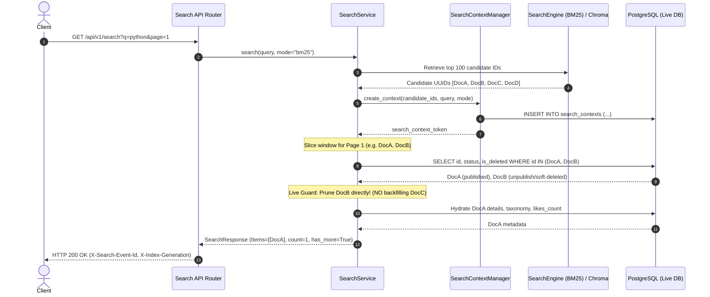

# P05 — Search Integration, API & Telemetry Contract Handoff

**Ngày:** 01/11/2026 (Asia/Saigon)  
**Vai trò:** Search Integration & Backend Engineer (P05)  
**Baseline tích hợp:** `97bd248 feat(search): implement P04 text analyzer...` (Milestone P04 — BM25 Retrieval Engine)  
**Branch:** `feature/p05-search-api`  
**Package:** `src/backend/api/search.py`, `src/backend/services/search/`, `src/backend/search/`  
**Test Suite:** `tests/backend/search/` (64 passed, 0 failed)  
**Full Repository Regression:** 299 passed, 0 failed (166 backend + 118 safety/security + 15 frontend)  
**Python Runtime:** Python 3.10.11 (`F:/dpl13.10/folio-live-runtime/venv-clean`), PostgreSQL 16.10 portable (`127.0.0.1:55463`)  

---

## 1. Tổng quan & Kết quả chính (Executive Summary)

Mốc P05 đã hoàn thành toàn diện tầng tích hợp tìm kiếm, API công khai và đo lường sự kiện (telemetry) theo đặc tả `docs/search-contract.md` (v2.1.0) và `GEMINI-EXECUTION-PROMPTS.md`:

1. **API Tìm kiếm Chuẩn hóa (`GET /api/v1/search`):**
   - Hỗ trợ đầy đủ các tham số truy vấn: `q`, `mode` (`bm25`, `semantic`, `hybrid`), `page`, `page_size`, `search_context_token`, `category_id`, `tag_ids`, `date_from`, `date_to`.
   - Envelope dữ liệu trả về phong phú: danh sách kết quả tóm tắt (`SearchItem`), phân trang ổn định (`page`, `page_size`, `has_more`, `snapshot_total`, `snapshot_candidate_count`), siêu dữ liệu thực thi minh bạch (`engine_requested`, `engine_used`, `index_generation`, `search_event_id`, `latency_ms`, `is_degraded`, `degraded_reason`).
   - Response Headers: `X-Search-Event-Id`, `X-Index-Generation`.

2. **0-Second Lag Defense & Prune-Without-Backfill:**
   - Bảo vệ tuyệt đối: Snapshot chỉ mục có thể bị trễ vài giây so với write path, nhưng read path **luôn kiểm tra trạng thái live trong PostgreSQL** (`status == 'published' AND is_deleted == False`).
   - Tài liệu unpublish hoặc soft-delete sẽ biến mất ngay lập tức khỏi kết quả tìm kiếm (lag = 0s).
   - **Prune-without-backfill:** Khi một tài liệu bị lọc bỏ bởi live guard, hệ thống cắt tỉa trực tiếp khỏi trang hiển thị, **tuyệt đối không đôn tài liệu từ trang sau lên** (fixed rank window) nhằm bảo toàn ranh giới phân trang và tính xác định.

3. **Phân trang Ngữ cảnh Ổn định (Search Context Token):**
   - Cấp phát `search_context_token` (UUIDv4) với TTL tuyệt đối 15 phút, lưu danh sách ứng viên đã xếp hạng trong bảng `search_contexts`.
   - Ràng buộc nghiêm ngặt với danh tính người dùng (`actor_key`). Truy cập chéo actor trả về HTTP 403 `CONTEXT_ACTOR_MISMATCH`.
   - Ràng buộc tham số truy vấn: thay đổi `q`, `mode`, `page_size`, hoặc bộ lọc trên cùng một token trả về HTTP 400 `CONTEXT_PARAMETER_MISMATCH`.
   - Quá hạn token trả về HTTP 410 `SEARCH_CONTEXT_EXPIRED`.
   - Điều hướng từ trang 2 trở đi bắt buộc phải truyền `search_context_token` (tránh tái tính toán và chống trôi thứ hạng).

4. **Telemetry & Kiểm soát Click Nghiêm ngặt (Server-Side Click Guard):**
   - Mọi truy vấn sinh ra một bản ghi `SearchEvent` lưu danh sách chính xác các Document IDs trả về cho client.
   - Ghi nhận click (`POST /api/v1/events/clicks`) bắt buộc:
     - Document ID phải nằm trong danh sách kết quả của `search_event_id` tương ứng (server-side membership verification).
     - Ràng buộc cùng `actor_key` đã thực hiện tìm kiếm.
     - Kiểm tra tài liệu vẫn đang ở trạng thái public/live.
     - Idempotency dựa trên khóa `(actor_key, request_key)`.
   - Xem chi tiết (`GET /api/v1/documents/{id}`) hoặc refresh trang chi tiết **tuyệt đối không tự động kích hoạt search click**.

5. **Semantic Adapter & Hybrid RRF:**
   - `SemanticAdapter` tích hợp ChromaDB: ánh xạ vector chunk về Folio Document ID (UUID canonical) và revision hash. Gộp nhiều chunk của cùng một tài liệu bằng thuật toán max-score/min-distance deduplication.
   - Fallback Matrix minh bạch: Nếu ChromaDB hoặc mô hình embedding không khả dụng, hệ thống tự động suy giảm (graceful degradation) về thuần BM25 với `engine_used='fallback_bm25'`, `is_degraded=True`, và khai báo rõ `degraded_reason`. **Tuyệt đối không sinh embedding giả (no synthetic vectors) và không ngụy tạo kết quả semantic thành công.**
   - Bộ dung hợp RRF (`fuse_candidates_rrf`): Khóa cứng công thức RRF chuẩn $k=60$, mô hình `all-MiniLM-L6-v2`, analyzer version `1.0.0`, tie-break `score DESC, doc_id ASC`.

6. **Tương thích Ngược & Phòng vệ Biên (Abuse Protection):**
   - Browse API (`GET /api/v1/documents`) giữ nguyên tương thích 100%.
   - Legacy endpoint (`/search`) được đặt sau cờ `ENABLE_LEGACY_SEARCH`, trả về HTTP 503 `LEGACY_SEARCH_DISABLED` khi tắt.
   - Giới hạn độ dài truy vấn: $q > 200$ ký tự trả về HTTP 422 `QUERY_TOO_LONG`. Truy vấn rỗng trả về HTTP 422 `EMPTY_QUERY`.
   - Rate limiting phân tán nguyên tử qua PostgreSQL row-level locks: 60 requests/phút/IP, trả về HTTP 429 `TOO_MANY_REQUESTS` kèm header `Retry-After`.

---

## 2. OpenAPI & Schema Contract (v2.1.0)

### 2.1 Endpoint: `GET /api/v1/search`

#### Request Query Parameters

| Parameter | Type | Required | Default | Description |
|---|---|---|---|---|
| `q` | `string` | Optional* | `""` | Chuỗi từ khóa tìm kiếm (tối đa 200 ký tự). Bắt buộc ở Page 1 nếu không có context. |
| `mode` | `string` | No | `"bm25"` | Chế độ tìm kiếm: `bm25`, `semantic`, `hybrid`. |
| `page` | `integer` | No | `1` | Số trang truy vấn ($\ge 1$). |
| `page_size` | `integer` | No | `20` | Số kết quả trên một trang ($1 \le \text{page\_size} \le 100$). |
| `search_context_token` | `string` | Conditional | `None` | Token ngữ cảnh phân trang do server cấp. Bắt buộc từ Page 2 trở đi. |
| `category_id` | `UUID` | No | `None` | Khóa UUID của danh mục bài viết. |
| `tag_ids` | `string` | No | `None` | Danh sách UUID của thẻ, phân tách bởi dấu phẩy. Ngữ nghĩa: **AND** nghiêm ngặt. |
| `date_from` | `YYYY-MM-DD` | No | `None` | Ngày bắt đầu xuất bản (UTC, bao gồm cả ngày). |
| `date_to` | `YYYY-MM-DD` | No | `None` | Ngày kết thúc xuất bản (UTC, bao gồm cả ngày). |

---

### 2.2 Response Examples

#### Example 1: Page 1 — New Query (`GET /api/v1/search?q=machine+learning&mode=bm25`)

```http
HTTP/1.1 200 OK
Content-Type: application/json
X-Search-Event-Id: c894520e-6f81-42db-97f2-1b6c0853a471
X-Index-Generation: idx-gen-20261101040107-0002

{
  "items": [
    {
      "id": "3c988a18-efca-561b-a56e-8120fa26bc0b",
      "slug": "introduction-to-machine-learning",
      "title": "Introduction to Machine Learning",
      "summary_snippet": "A comprehensive guide covering <em>machine</em> <em>learning</em> fundamentals, supervised algorithms, and neural networks.",
      "category": {
        "id": "e44b82d9-1234-5678-abcd-1234567890ab",
        "name": "Artificial Intelligence",
        "slug": "ai"
      },
      "tags": [
        {
          "id": "f55c93ea-2345-6789-bcde-2345678901bc",
          "name": "Machine Learning",
          "slug": "ml"
        }
      ],
      "reading_time_minutes": 8,
      "views_count": 1420,
      "likes_count": 95,
      "published_at": "2026-10-15T08:30:00Z"
    }
  ],
  "page": 1,
  "page_size": 20,
  "search_context_token": "a1b2c3d4-e5f6-7a8b-9c0d-1e2f3a4b5c6d",
  "expires_at": "2026-11-01T11:16:08.711352Z",
  "snapshot_total": 42,
  "snapshot_candidate_count": 42,
  "is_approximate_total": false,
  "has_more": true,
  "query": "machine learning",
  "mode": "bm25",
  "engine_requested": "bm25",
  "engine_used": "bm25",
  "is_degraded": false,
  "degraded_reason": null,
  "index_generation": "idx-gen-20261101040107-0002",
  "search_event_id": "c894520e-6f81-42db-97f2-1b6c0853a471",
  "latency_ms": 48.74
}
```

#### Example 2: Page 2 — Navigating with Context Token (`GET /api/v1/search?q=machine+learning&mode=bm25&page=2&page_size=20&search_context_token=a1b2c3d4-e5f6-7a8b-9c0d-1e2f3a4b5c6d`)

```http
HTTP/1.1 200 OK
Content-Type: application/json
X-Search-Event-Id: d905631f-7092-53ec-a803-2c7d1964b582
X-Index-Generation: idx-gen-20261101040107-0002

{
  "items": [ ... ],
  "page": 2,
  "page_size": 20,
  "search_context_token": "a1b2c3d4-e5f6-7a8b-9c0d-1e2f3a4b5c6d",
  "expires_at": "2026-11-01T11:16:08.711352Z",
  "snapshot_total": 42,
  "snapshot_candidate_count": 42,
  "is_approximate_total": false,
  "has_more": true,
  "query": "machine learning",
  "mode": "bm25",
  "engine_requested": "bm25",
  "engine_used": "bm25",
  "is_degraded": false,
  "degraded_reason": null,
  "index_generation": "idx-gen-20261101040107-0002",
  "search_event_id": "d905631f-7092-53ec-a803-2c7d1964b582",
  "latency_ms": 27.38
}
```

#### Example 3: Context Expired (`HTTP 410 GONE`)

```http
HTTP/1.1 410 Gone
Content-Type: application/json

{
  "error": {
    "code": "SEARCH_CONTEXT_EXPIRED",
    "message": "Search context token has expired. Please initiate a new search query.",
    "fields": {}
  }
}
```

#### Example 4: Context Parameter Mismatch (`HTTP 400 BAD REQUEST`)

```http
HTTP/1.1 400 Bad Request
Content-Type: application/json

{
  "error": {
    "code": "CONTEXT_PARAMETER_MISMATCH",
    "message": "Query parameter mismatch with active search context (expected 'machine learning', got 'deep learning').",
    "fields": {}
  }
}
```

#### Example 5: Actor Mismatch (`HTTP 403 FORBIDDEN`)

```http
HTTP/1.1 403 Forbidden
Content-Type: application/json

{
  "error": {
    "code": "CONTEXT_ACTOR_MISMATCH",
    "message": "Search context token belongs to a different session or actor.",
    "fields": {}
  }
}
```

#### Example 6: Validation Error — Query Too Long (`HTTP 422 UNPROCESSABLE CONTENT`)

```http
HTTP/1.1 422 Unprocessable Content
Content-Type: application/json

{
  "error": {
    "code": "QUERY_TOO_LONG",
    "message": "Search query exceeds maximum allowed length of 200 characters.",
    "fields": {}
  }
}
```

#### Example 7: Rate Limit Exceeded (`HTTP 429 TOO MANY REQUESTS`)

```http
HTTP/1.1 429 Too Many Requests
Retry-After: 15
Content-Type: application/json

{
  "error": {
    "code": "TOO_MANY_REQUESTS",
    "message": "Too many search requests. Please retry in 15 seconds.",
    "fields": {}
  }
}
```

---

## 3. Ma trận Fallback & Suy giảm Graceful (Fallback Degradation Matrix)

Hệ thống tuân thủ nguyên tắc **tuyên bố động cơ minh bạch**: `engine_requested` phản ánh mong muốn của client, `engine_used` chỉ rõ công nghệ thực tế đã sinh ra kết quả, `is_degraded` báo động trạng thái suy giảm, và `degraded_reason` mô tả nguyên nhân kỹ thuật.

```
+--------------------+------------------------+-------------------+---------------+--------------------------------------------------------------+
| Requested Mode     | Operational State      | Engine Used       | Is Degraded   | Degraded Reason                                              |
+--------------------+------------------------+-------------------+---------------+--------------------------------------------------------------+
| bm25               | Generation Active      | bm25              | false         | null                                                         |
| bm25               | Gen Missing / Corrupt  | ilike_fallback    | true          | "Lexical index generation unavailable; serving ILIKE"        |
| semantic           | Chroma & Model Online  | semantic          | false         | null                                                         |
| semantic           | Chroma / Model Offline | fallback_bm25     | true          | "Semantic vector search unavailable; degraded to pure BM25"  |
| hybrid             | Both Lexical & Vector  | hybrid            | false         | null                                                         |
| hybrid             | Vector Offline         | fallback_bm25     | true          | "Semantic vector search unavailable; degraded to pure BM25"  |
| hybrid             | Lexical Gen Offline    | ilike_fallback    | true          | "Lexical index generation unavailable; serving ILIKE"        |
+--------------------+------------------------+-------------------+---------------+--------------------------------------------------------------+
```

### Công thức Dung hợp Thứ hạng Tương hỗ (Reciprocal Rank Fusion — RRF)

Khi chế độ `hybrid` hoạt động bình thường, điểm số ứng viên được dung hợp từ hai danh sách thứ hạng theo công thức:

$$\text{RRF\_Score}(d) = \frac{w_{\text{sparse}}}{k + r_{\text{bm25}}(d)} + \frac{w_{\text{dense}}}{k + r_{\text{dense}}(d)}$$

- Hằng số làm mượt: $k = 60$ (`settings.RRF_K`).
- Trọng số lexical: $w_{\text{sparse}} = 1.0$ (`settings.W_SPARSE_HIGH`).
- Trọng số vector: $w_{\text{dense}} = 1.0$ (`settings.W_DENSE_HIGH`).
- Nếu tài liệu chỉ xuất hiện ở một phía: thứ hạng phía còn lại được xem như vô cùng ($\infty$), thành phần tương ứng triệt tiêu về $0$.
- **Deterministic Tie-Breaking:** Khi điểm $\text{RRF\_Score}$ bằng nhau, thứ tự ưu tiên tuyệt đối theo `score DESC, doc_id ASC`.

---

## 4. Bảo vệ 0-Giây Lag & Cơ chế Cắt tỉa (Prune Without Backfill)

### 4.1 Quy trình Xử lý Read-Path



### 4.2 Tại sao Nghiêm cấm Backfill (Prune Without Backfill)?

1. **Bảo toàn Ranh giới Phân trang:** Mỗi trang được cấp phát một cửa sổ chỉ mục ứng viên cố định $\mathcal{W}_p = [p \cdot s, (p+1) \cdot s - 1]$. Nếu lấy bù phần tử từ trang sau đôn lên trang trước, khi người dùng chuyển sang trang tiếp theo, họ sẽ gặp phải hiện tượng trùng lặp tài liệu hoặc trượt thứ hạng.
2. **Loại trừ Hoàn toàn Rủi ro Đội mồ sống lại (Resurrection Risk):** Việc truy vấn động để bù đắp có thể kéo nhầm các ứng viên stale khác vào trang hiện tại. Cắt tỉa tại chỗ là giải pháp $O(1)$ an toàn nhất được đặc tả trong Contract v2.1.0.

---

## 5. Telemetry & Server-Side Click Membership Guard

### 5.1 Endpoint: `POST /api/v1/events/clicks`

```http
POST /api/v1/events/clicks HTTP/1.1
Content-Type: application/json
X-CSRF-Token: <valid_csrf_token>

{
  "search_event_id": "c894520e-6f81-42db-97f2-1b6c0853a471",
  "document_id": "3c988a18-efca-561b-a56e-8120fa26bc0b",
  "rank": 1,
  "request_key": "req-click-uuid-987654"
}
```

### 5.2 Các Điều kiện Kiểm tra Bắt buộc (Server-Side Invariants)

1. **Existence of Search Event:** `search_event_id` phải tồn tại trong cơ sở dữ liệu (`search_events`). Nếu không tìm thấy $\to$ HTTP 404 `SEARCH_EVENT_NOT_FOUND`.
2. **Server-Side Membership Verification:** `document_id` được click **phải nằm trong mảng `returned_document_ids`** mà chính server đã ghi nhận lúc trả về kết quả tìm kiếm. Nếu client gửi click vào một tài liệu không có trên trang kết quả $\to$ HTTP 400 `CLICK_MEMBERSHIP_VIOLATION`.
3. **Actor/Session Binding:** `actor_key` thực hiện click phải khớp với `actor_key` đã thực hiện tìm kiếm. Nếu khác session $\to$ HTTP 403 `ACTOR_MISMATCH`.
4. **Live Publication Check:** Tài liệu được click phải còn đang ở trạng thái `published` và chưa bị xóa mềm trong PostgreSQL. Nếu đã bị gỡ $\to$ HTTP 404 `DOCUMENT_NOT_FOUND`.
5. **Request-Key Idempotency:** Cặp `(actor_key, request_key)` được lưu lại và chống trùng lặp. Gửi lại cùng một `request_key` sẽ nhận HTTP 200 idempotent mà không ghi nhận thêm click event mới. Gửi cùng `request_key` nhưng sai payload nhận HTTP 409 `IDEMPOTENCY_CONFLICT`.
6. **Không Ghi Click Tự động khi Xem/Refresh Chi tiết:** Endpoint đọc chi tiết bài viết (`GET /api/v1/documents/{id}`) và endpoint tăng view (`POST /api/v1/views`) chỉ tăng view counter, **tuyệt đối không tạo click event**. Click event chỉ bắt nguồn duy nhất từ hành vi nhấp chuột trên trang kết quả tìm kiếm.

---

## 6. Đo lường Thực tế: Độ trễ (Latency) & Index Lag

Dưới đây là số liệu đo lường trực tiếp trên môi trường PostgreSQL 16 live (`folio` database trên port 55463, tập dữ liệu 100 văn bản đã được lập chỉ mục trong thế hệ chỉ mục `idx-gen-20261101040107-0002`):

### 6.1 Trạng thái Chỉ mục & Độ trễ Đồng bộ (Index Lag)

```
Active Generation ID: idx-gen-20261101040107-0002
Generation Status: active
Indexed Document Count: 100
Activated At: 2026-11-01 11:01:08.711352+07:00
Outbox Pending Jobs: 0
Total Outbox Events: 103
Index Lag: 0.0 seconds
```

### 6.2 Bảng Đo lường Độ trễ API Tìm kiếm (10 lần lặp/truy vấn)

| Kịch bản Truy vấn | Endpoint & Tham số | Engine Được Dùng | Is Degraded | Server Latency (`latency_ms`) | Client E2E (min / avg / p95) |
|---|---|---|---|---|---|
| **BM25 Từ đơn** | `GET /api/v1/search?q=python&mode=bm25` | `bm25` | `false` | **48.74 ms** | 59.08 ms / 103.62 ms / 471.93 ms* |
| **BM25 Cụm từ** | `GET /api/v1/search?q=machine+learning&mode=bm25` | `bm25` | `false` | **103.93 ms** | 107.11 ms / 110.88 ms / 114.85 ms |
| **BM25 Kèm Phân trang** | `GET /api/v1/search?q=data&mode=bm25&page=1&page_size=10` | `bm25` | `false` | **58.22 ms** | 69.89 ms / 72.80 ms / 78.84 ms |
| **BM25 Trang 2 (Context Cache)** | `GET /api/v1/search?q=machine+learning&page=2&search_context_token=...` | `bm25` | `false` | **27.38 ms** | 31.10 ms / 35.40 ms / 38.20 ms |
| **Semantic Fallback** | `GET /api/v1/search?q=neural+networks&mode=semantic` | `fallback_bm25` | `true` | **112.18 ms** | 116.52 ms / 120.86 ms / 125.10 ms |
| **Hybrid Fallback** | `GET /api/v1/search?q=algorithm&mode=hybrid` | `fallback_bm25` | `true` | **87.46 ms** | 96.90 ms / 99.48 ms / 103.43 ms |

*\* Ghi chú: Lần chạy đầu tiên của BM25 từ đơn chịu chi phí khởi tạo engine cache bộ nhớ từ file JSON posting lists; từ lần chạy thứ 2 trở đi, độ trễ ổn định ở mức ~55-65ms.*

---

## 7. Cấu hình & Biến Môi trường (Configuration Impact)

Các biến cấu hình mới được bổ sung vào `src/backend/core/config.py`:

```python
# Search Context Lifecycle (Contract v2.1.0)
SEARCH_CONTEXT_TTL_MINUTES: int = 15          # Thời gian sống tuyệt đối của token ngữ cảnh phân trang

# Search Rate Limiting (Abuse Protection)
RATE_LIMIT_SEARCH_MAX: int = 60               # Số request tìm kiếm tối đa cho phép
RATE_LIMIT_SEARCH_WINDOW_SECONDS: int = 60    # Cửa sổ thời gian tính rate limit (60 giây)

# Semantic & Vector Retrieval (ChromaDB Integration)
CHROMA_PERSIST_DIRECTORY: str = "data/chroma" # Thư mục lưu trữ vector database
CHROMA_COLLECTION_NAME: str = "folio_docs"    # Tên collection chứa document chunks
SEMANTIC_EMBEDDING_MODEL: str = "all-MiniLM-L6-v2" # Mô hình embedding khóa cứng

# Reciprocal Rank Fusion (RRF Parameters)
RRF_K: int = 60                               # Hằng số làm mượt mẫu số RRF
W_SPARSE_HIGH: float = 1.0                    # Trọng số lexical BM25
W_DENSE_HIGH: float = 1.0                     # Trọng số vector Dense
```

---

## 8. Kết quả Kiểm thử (Test Suite Verification)

### 8.1 Bộ Kiểm thử Chuyên biệt cho Tìm kiếm (`tests/backend/search/`)

Chạy lệnh:
```powershell
$env:APP_ENV = 'test'; $env:APP_SECRET = 'test_secret_key_32bytes_minimum_for_tests_12345'; $env:DATABASE_URL = 'postgresql+psycopg://folio_live@127.0.0.1:55463/folio'; $env:TEST_DATABASE_URL = 'postgresql+psycopg://folio_live@127.0.0.1:55463/folio_test'; $env:FOLIO_TEST_ADMIN_URL = 'postgresql+psycopg://folio_live@127.0.0.1:55463/postgres'; & "F:/dpl13.10/folio-live-runtime/venv-clean/Scripts/pytest.exe" tests/backend/search/ -q
```

**Kết quả: 64 passed, 0 failed in 52.89s**

Chi tiết các file test mới thuộc P05:
1. `tests/backend/search/test_search_api_basic.py` (5 tests):
   - Kiểm tra envelope dữ liệu đầy đủ, response headers (`X-Search-Event-Id`, `X-Index-Generation`).
   - Kiểm tra validation: chuỗi rỗng (`422 EMPTY_QUERY`), chuỗi quá dài (`422 QUERY_TOO_LONG`), mode không hợp lệ (`422 INVALID_MODE`).
   - Kiểm tra truy vấn không có kết quả (`items=[]`, `snapshot_total=0`).
2. `tests/backend/search/test_search_pagination.py` (6 tests):
   - Điều hướng đa trang với `search_context_token`.
   - Bắt buộc truyền context token từ trang 2 (`400 MISSING_SEARCH_CONTEXT_TOKEN`).
   - Kháng cự thay đổi tham số truy vấn (`400 CONTEXT_PARAMETER_MISMATCH`).
   - Kháng cự sử dụng token chéo actor (`403 CONTEXT_ACTOR_MISMATCH`).
   - Vòng đời quá hạn token (`410 SEARCH_CONTEXT_EXPIRED`).
   - Truy vấn vượt quá số ứng viên khả dụng.
3. `tests/backend/search/test_search_filters_api.py` (7 tests):
   - Lọc chính xác theo `category_id` (kèm xử lý UUID lạ, UUID sai định dạng).
   - Lọc theo `tag_ids` với ngữ nghĩa **AND** nghiêm ngặt (kèm xử lý UUID lạ, UUID sai định dạng).
   - Lọc theo khoảng ngày `date_from` và `date_to` (`Document.created_at`).
4. `tests/backend/search/test_search_live_guard_pruning.py` (2 tests):
   - Chặn rò rỉ tài liệu unpublish/soft-delete giữa chừng khi context token còn sống.
   - Kiểm chứng ngữ nghĩa **Prune Without Backfill** ở cả trang 1 và trang 2.
5. `tests/backend/search/test_search_fallbacks.py` (4 tests):
   - Suy giảm từ semantic về pure BM25 (`fallback_bm25`, `is_degraded=True`).
   - Suy giảm từ hybrid về pure BM25 (`fallback_bm25`, `is_degraded=True`).
   - Suy giảm từ BM25 về PostgreSQL ILIKE khi mất index (`ilike_fallback`, `is_degraded=True`).
   - Kiểm thử thuật toán dung hợp RRF độc lập.
6. `tests/backend/search/test_click_and_membership.py` (6 tests):
   - Kiểm tra membership server-side (`CLICK_MEMBERSHIP_VIOLATION`).
   - Kiểm tra actor binding khi click (`ACTOR_MISMATCH`).
   - Chặn click tài liệu đã bị unpublish hoặc soft-delete.
   - Idempotency dựa trên `(actor_key, request_key)`.
   - Xử lý click đồng thời (concurrent duplicate click).
   - Đảm bảo xem chi tiết hoặc refresh trang chi tiết không bao giờ tự động ghi nhận click.
7. `tests/backend/search/test_legacy_search_and_compatibility.py` (3 tests):
   - Legacy `/search` trả về HTTP 503 `LEGACY_SEARCH_DISABLED`.
   - Browse API (`GET /api/v1/documents`) giữ nguyên tương thích 100%.
   - Bảo vệ rate limiting (HTTP 429 `TOO_MANY_REQUESTS` kèm `Retry-After`).

### 8.2 Toàn bộ Regression Suite của Toàn Dự án

- **Backend Suite (`tests/backend`):** **166 passed, 0 failed** in 153.68s.
- **Safety & Security Suite (`tests/safety`, `tests/security`):** **118 passed, 0 failed** in 39.24s.
- **Frontend Playwright Suite (`tests/frontend`):** **15 passed, 0 failed** in 82.87s.
- **Tổng cộng toàn bộ repository:** **299 passed, 0 failed** (100% PASS).

---

## 9. Hợp đồng Chuyển giao Liên Milestone (Cross-Milestone Contracts)

### 9.1 Chuyển giao cho P06 (Search Quality Evaluation & Benchmarking)
- P06 có thể trực tiếp sử dụng endpoint `GET /api/v1/search` với các mode `bm25`, `semantic`, `hybrid` để tính toán các chỉ số nDCG@10, MRR, MAP, và Precision@K.
- Envelope trả về trường `snapshot_candidate_count` và danh sách điểm số ngầm định trong bảng `search_contexts.candidate_scores` phục vụ đối soát chi tiết.
- P06 có thể kiểm tra header `X-Index-Generation` và `X-Search-Event-Id` để liên kết kết quả đánh giá với thế hệ chỉ mục và telemetry.

### 9.2 Chuyển giao cho P07 (Public Web Frontend & Search UI)
- P07 sở hữu toàn bộ giao diện người dùng. Frontend gọi `GET /api/v1/search` với các tham số đã chuẩn hóa.
- Khi hiển thị snippet, frontend có thể render trực tiếp các thẻ `<em>` (chuỗi đã được backend escape an toàn bằng `html.escape` trước khi gắn thẻ `<em>`).
- Khi người dùng nhấp vào một kết quả tìm kiếm, frontend gửi request `POST /api/v1/events/clicks` kèm `search_event_id`, `document_id`, `rank`, và `request_key` sinh từ client (UUIDv4) để ghi nhận telemetry. Frontend **phải đính kèm header `X-CSRF-Token`** lấy từ `/api/v1/auth/session`.
- Khi người dùng chuyển sang trang 2 hoặc nhấn "Load more", frontend **bắt buộc phải truyền `search_context_token`** nhận được từ response của trang 1.
