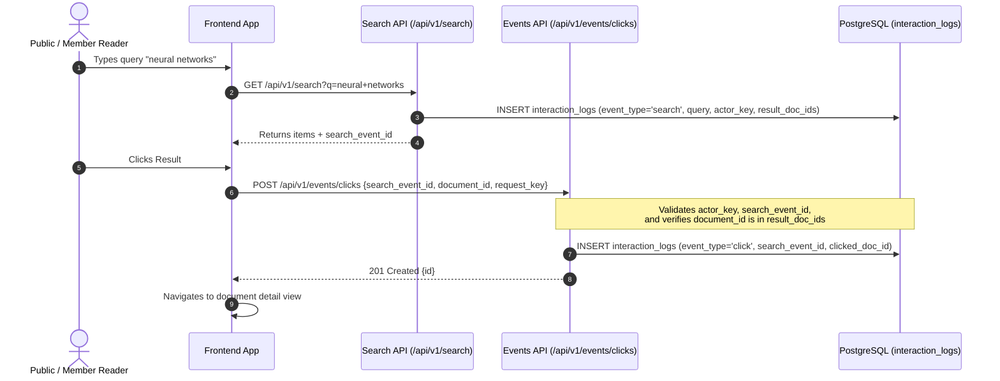

# Folio Information Retrieval & Search Contract

**Contract Version:** 2.0.0 (Search Contract Frozen)  
**Date:** 2026-10-31  
**Lead Architect / QA:** Lead Architect & QA Lead  
**Scope:** Search API specifications, data models, interaction logging, fallback policies, and backward compatibility.

---

## 1. Core Architectural Tenets

1. **Canonical Identifier:**
   - The **Folio Document ID** (`documents.id`, a standard UUIDv4 string) is the **single canonical key** throughout the entire system: PostgreSQL, inverted index posting lists, ChromaDB vector metadata, search responses, and interaction logs.
   - The document's source URL (`source_url`) is strictly **source metadata** for provenance, attribution, and external reference. URLs, crawler auto-increment IDs, and file names MUST NOT be used as primary identifiers in any new runtime service.

2. **Source of Truth:**
   - PostgreSQL is the authoritative source of truth for document state, publication status, taxonomy, and access control.
   - The retrieval indexes (lexical inverted index, vector store) are derived read caches. Any write mutation (create, update, publish, unpublish, delete) triggers an index synchronization event via a transactional outbox queue.

---

## 2. API Contract: `GET /api/v1/search`

The primary endpoint for information retrieval is `/api/v1/search`.

### 2.1 Request Parameters

| Parameter | Type | Required | Default | Validation & Rules |
| :--- | :--- | :--- | :--- | :--- |
| `q` | `string` | **Yes** | — | Cleaned query string (1–200 characters). Stripped of leading/trailing whitespace. Whitespace-only queries return `422 Unprocessable Entity`. |
| `mode` | `string` | No | `bm25` | Allowed values: `bm25`, `semantic`, `hybrid`. If an unsupported mode is provided, return `422`. |
| `category_id` | `UUID string` | No | `null` | Must be a valid UUID existing in `categories.id`. Filters results to documents in this category. |
| `tag_ids` | `string` | No | `null` | Comma-separated list of UUID strings. Filter applies **AND semantics** (matching documents must possess all specified tags). |
| `date_from` | `date` (`YYYY-MM-DD`) | No | `null` | Inclusive start timestamp: `date_from 00:00:00 UTC`. |
| `date_to` | `date` (`YYYY-MM-DD`) | No | `null` | Inclusive end timestamp: `date_to 23:59:59.999999 UTC`. If `date_from > date_to`, return `422`. |
| `page` | `integer` | No | `1` | Must be \(\ge 1\). If requested page exceeds `total_pages`, return empty items (`items: []`), do not error or redirect. |
| `page_size` | `integer` | No | `20` | Minimum `1`, maximum `100`. |

### 2.2 Response Specification

HTTP Status: `200 OK`

```json
{
  "items": [
    {
      "id": "550e8400-e29b-41d4-a716-446655440000",
      "title": "Deep Learning: Foundations and Practice",
      "summary": "An extensive overview of neural networks, backpropagation, and optimization.",
      "snippet": "Recent advancements in <em>deep learning</em> have revolutionized representation learning...",
      "score": 14.8251,
      "rank": 1,
      "author": "Wikipedia contributors",
      "category": {
        "id": "7c9e6679-7425-40de-944b-e07fc1f90ae7",
        "name": "Artificial Intelligence",
        "slug": "artificial-intelligence"
      },
      "tags": [
        {
          "id": "3b241101-e2bb-4255-8daf-4136b6339029",
          "name": "Machine Learning",
          "slug": "machine-learning"
        }
      ],
      "published_at": "2026-10-31T12:00:00Z",
      "views_count": 142,
      "likes_count": 28,
      "cover_image_url": "https://example.org/images/dl.jpg",
      "cover_image_alt": "Neural network architecture diagram",
      "source_url": "https://en.wikipedia.org/wiki/Deep_learning"
    }
  ],
  "page": 1,
  "page_size": 20,
  "total": 1,
  "total_pages": 1,
  "query": "deep learning",
  "mode": "bm25",
  "engine_requested": "bm25",
  "engine_used": "bm25",
  "is_degraded": false,
  "degraded_reason": null,
  "index_generation": "idx-gen-20261031-01",
  "search_event_id": "a1b2c3d4-e5f6-7890-abcd-ef1234567890",
  "latency_ms": 12.4
}
```

---

## 3. Publication, Deletion & Stale Index Defense

### 3.1 Strict Publication Invariant
Under **no circumstance** may a document be returned in search results if:
1. `status != 'published'` (e.g. `status == 'draft'`), OR
2. `deleted_at IS NOT NULL` (soft-deleted).

### 3.2 Defense-in-Depth against Index Lag
Because asynchronous indexing introduces a potential propagation lag:
- The search pipeline MUST verify candidate document IDs against live PostgreSQL state (or apply a mandatory live relational filter) before assembling the response payload.
- If a candidate document returned by BM25 or Chroma was unpublished or deleted after the index generation was created, it MUST be pruned from the result set automatically without raising an error.

---

## 4. Ranking, Scoring & Ordering Rules

1. **Candidate Retrieval & Scoring:**
   - BM25 mode executes Okapi BM25 ranking against the lexical inverted index.
   - Title boost (\(w_{title}\)) may be configured to amplify matches occurring in document titles.
   - In hybrid mode, reciprocal rank fusion (RRF) or normalized linear combination fuses lexical BM25 and vector similarity scores.

2. **Deterministic Tie-Breaking:**
   - Primary sort key: `score DESC` (higher relevance first).
   - Strict tie-breaker key: `document.id ASC` (guaranteeing deterministic pagination order when scores are identical).

---

## 5. Interaction Logging Contract

Interaction tracking is required for offline evaluation, ranking optimization, and analytics.



### 5.1 Search Event Logging
- Every successful call to `GET /api/v1/search` with a non-empty query logs an `interaction_logs` record:
  - `event_type`: `"search"`
  - `query_string`: Cleaned search query
  - `actor_key`: Session actor token (opaque, server-issued)
  - `user_id`: Authenticated user UUID or `null` for guests
  - `timestamp`: UTC now
  - `result_doc_ids`: JSON array containing the ordered list of `Document.id` UUIDs returned on this page
  - `clicked_doc_id`: `null`
  - `search_event_id`: `null` (self-referencing parent)
- The newly created log UUID is returned in the response header and body as `search_event_id`.

### 5.2 Click Event Logging (`POST /api/v1/events/clicks`)
- Dispatched when a reader clicks a search result:
  ```json
  {
    "search_event_id": "a1b2c3d4-e5f6-7890-abcd-ef1234567890",
    "document_id": "550e8400-e29b-41d4-a716-446655440000",
    "request_key": "c0a80101-0000-0000-0000-000000000001"
  }
  ```
- **Validation Rules:**
  1. `search_event_id` must exist and have `event_type == 'search'`.
  2. The current session's `actor_key` must match the `actor_key` of the original search event.
  3. `document_id` must be present in the original search's `result_doc_ids` list.
  4. The target document must currently be published and not deleted.
- **Persistence & Idempotency:**
  - A separate record is inserted into `interaction_logs` with `event_type = 'click'`, `clicked_doc_id = document_id`, and `search_event_id` linking back to the parent search.
  - Idempotency is enforced by the database unique constraint `(actor_key, search_event_id, clicked_doc_id, request_key)`. Repeated clicks or network retries with the same `request_key` return the existing click event ID with status `200 OK` / `201 Created` without duplicating records.

### 5.3 View Event Logging
- Detail views log navigation via `POST /api/v1/documents/{id}/views` with `{ "navigation_id": "<UUID>" }`.
- Deduplication is strictly enforced by `(actor_key, document_id, navigation_id)`.
- Client-side page reload, back navigation, or tab focus MUST NOT emit duplicate click events.

---

## 6. Fallback & Graceful Degradation Policy

The system guarantees continuous service availability through explicit fallback paths. A failure in an advanced retrieval tier must never result in an unhandled 500 error:

| Requested Mode | Failure Condition | Fallback Action | `engine_used` | `is_degraded` | `degraded_reason` |
| :--- | :--- | :--- | :--- | :--- | :--- |
| `semantic` | ChromaDB service down or unreachable | Fallback to Okapi BM25 | `fallback_bm25` | `true` | `"ChromaDB service unreachable"` |
| `semantic` | Embedding model offline or out-of-memory | Fallback to Okapi BM25 | `fallback_bm25` | `true` | `"SentenceTransformer model unavailable"` |
| `hybrid` | ChromaDB or embedding model failure | Fallback to pure Okapi BM25 | `fallback_bm25` | `true` | `"Vector component unavailable; serving BM25"` |
| `bm25` | Inverted index corrupt or generation missing | Fallback to PostgreSQL SQL `ILIKE` | `ilike_fallback` | `true` | `"Lexical index generation unavailable; serving ILIKE"` |

> [!CAUTION]
> **No Fake Success:** The search service MUST NOT synthesize mock embeddings or fake semantic similarity scores. When a fallback occurs, it must be transparently reported in `engine_used` and `is_degraded`.

---

## 7. Backward Compatibility & Route Coexistence

To ensure seamless transition during development and release:

1. **`GET /api/v1/documents` (Catalog & Browse):**
   - Retained without breaking changes. Continues serving standard catalog pagination, sorting (`newest`, `oldest`, `title`), and filtering (`category_id`, `tag_ids`, `date_from`, `date_to`).
   - Keyword filtering on this endpoint remains SQL `ILIKE` for lightweight administrative and direct catalog listing.

2. **`GET /search` (Legacy Prototype):**
   - Kept behind the `ENABLE_LEGACY_SEARCH` configuration toggle.
   - When `ENABLE_LEGACY_SEARCH=false` (default), calling `/search` returns HTTP 503 with code `LEGACY_SEARCH_DISABLED`.
   - When enabled, it executes the legacy URL-based prototype for regression comparison.
