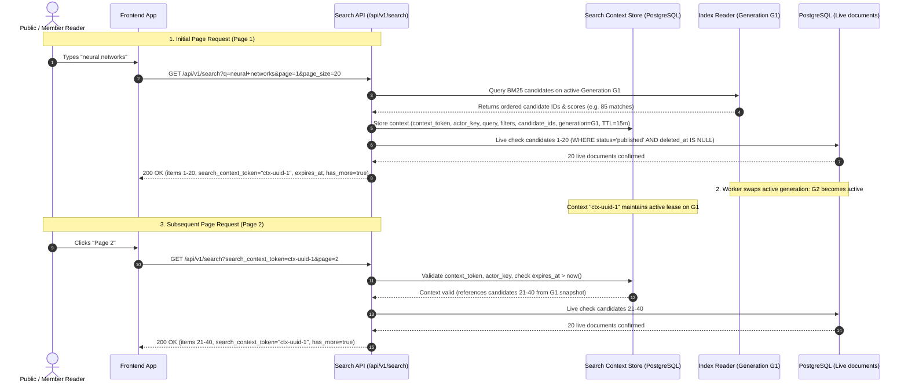

# Folio Information Retrieval & Search Contract

**Contract Version:** 2.1.0 (Integration A Remediation R03 — Approved Specification)  
**Date:** 2026-11-01  
**Lead Architect / Search Contract Owner:** Search Contract Owner & QA Lead  
**Scope:** Search API specifications, canonical identifiers, pagination stability, generation lifecycle leases, publication defense, interaction logging, fallback policies, and cross-milestone ownership.  
**Specification Status:** `APPROVED SPECIFICATION (LOCKED FOR P03-P05 IMPLEMENTATION)`  
**Runtime Implementation Status:** `PROPOSED SPECIFICATION — PENDING RUNTIME IMPLEMENTATION IN P03-P05` (Current codebase serves library browsing via `/api/v1/documents` and legacy `/search` behind feature toggle; `/api/v1/search` is specified here for upcoming implementation).

---

## 1. Core Architectural Tenets & Canonical Identifier (Remediation IA-04)

### 1.1 Canonical Document Identifier: Existing Folio UUIDs (v4 & v5)
1. **The Folio Document ID (`documents.id`, standard 36-character UUID string) is the sole canonical key** throughout the entire system:
   - Primary key in PostgreSQL (`documents.id`).
   - Document identifier in inverted index posting lists and corpus metadata.
   - Vector identifier and metadata key in ChromaDB.
   - Document identifier in search API response payloads (`items[].id`).
   - Foreign key in interaction and audit logs (`interaction_logs.clicked_doc_id`, `result_doc_ids`).
2. **UUID Version Support:**
   - **Canonical Identifier Definition:** The system accepts and treats any valid UUID string representation as canonical. Both **UUIDv5** (derived from namespace + source URL in reproducible datasets) and **UUIDv4** (randomly generated) are fully valid canonical IDs.
   - **Default for New Documents:** Newly authored documents created via Admin UI or `POST /api/v1/admin/documents` default to UUIDv4 generated by `src/backend/models/document.py::gen_uuid()` (`uuid.uuid4()`).
   - **Preservation of Existing IDs:** System components MUST NOT enforce `UUID.version == 4` on pre-existing documents. Any validator, serializer, or database column (`String(36)`) MUST accept any RFC 4122 UUID format.

### 1.2 Fixture Ground Truth & Preservation (No 165/162 Claims)
- **Canonical Seed Fixture:** [`fixtures/folio/documents.jsonl`](file:///F:/dpl13.10/WikiSearchEngine-ia-fix/fixtures/folio/documents.jsonl)
- **Exact Document Count:** **Exactly 103 documents** (100 `status: "published"`, 3 `status: "draft"`).
- **Exact Fixture SHA256 (LF line endings):** `379271ec6ade8afaec0ba3dc836d8334f6defea76020813e07c7f4e568be9af6`.
- **UUID Composition:** 103 of 103 documents (100%) possess **UUIDv5** identifiers.
- **Source URL Mapping:** 103 of 103 documents possess distinct, unique `source_url` values.
- **Taxonomy Counts in Fixture:** 6 categories (`artificial-intelligence`, `computational-biology`, `neuroscience`, `quantum-computing`, `renewable-energy`, `robotics`) and 154 unique tags.
- **Historical Count Correction:** Legacy documentation claims of "165 documents" or "162 published" are superseded historical artifacts. The verified canonical ground truth is 103 documents.
- **Ingestion & Importer Mandate:** The corpus importer in P03 MUST map `source_url -> existing Document.id` idempotently. It MUST NEVER overwrite or re-mint canonical IDs of existing fixture records.

### 1.3 PostgreSQL as Authoritative Source of Truth
- PostgreSQL is the sole authoritative store for document content, publication lifecycle (`status`), soft-deletion (`deleted_at`), taxonomy associations, and permissions.
- Inverted indexes and vector stores are derived read caches.
- Every state mutation (create, update, publish, unpublish, soft-delete) emits an outbox event within the same database transaction.

---

## 2. Pagination Stability & Generation Lifecycle (Remediation IA-05)

### 2.1 The Stability Problem: Why Generation Pinning Alone Fails
Pinning a search request to an `index_generation` (e.g. `idx-gen-G1`) is necessary but **insufficient** on its own:
1. **Intra-Generation Index Mutations:** If an index worker performs in-place posting list updates within generation G1, candidate rankings and offsets drift between page 1 and page 2.
2. **Inter-Generation Swapping:** When the background worker promotes `idx-gen-G2` as the active generation, a reader requesting page 2 without context would either be silently switched to G2 (causing skipped or duplicate documents due to ranking score shifts) or crash if G1 was prematurely purged.
3. **Floating-Point Tie Drift:** Retrieval scores often tie across multiple documents. Without an immutable snapshot or deterministic tie-breaker, pagination order is non-deterministic.

### 2.2 Final Architectural Decision: Server-Issued Actor-Bound Search Context
Folio locks **MỘT (1) cơ chế duy nhất**: **Server-Issued Actor-Bound Search Context** (Candidate Snapshot Cursor).



### 2.3 Core Invariants of the Search Context Mechanism

1. **Server-Issued Context Token (`search_context_token`):**
   - On the first page of a search (`page=1` without `search_context_token`), the Search API evaluates retrieval, constructs the ranked candidate ID list, persists the context, and returns a unique `search_context_token` (UUIDv4) along with `expires_at`.
   - On subsequent pages (`page >= 2`), the client MUST pass `search_context_token=<UUID>`.
2. **Actor & Parameter Binding:**
   - The search context is cryptographically or session-bound to the reader's `actor_key`. Cross-actor context access returns HTTP `403 Forbidden` (`code: CONTEXT_ACTOR_MISMATCH`).
   - The context strictly binds: `query`, `mode`, `category_id`, `tag_ids`, `date_from`, `date_to`, `page_size`, and `index_generation`.
   - If a client passes `search_context_token` but changes `query`, `mode`, `filters`, or `page_size`, the server rejects the request with HTTP `400 Bad Request` (`code: CONTEXT_PARAMETER_MISMATCH`). The client must initiate a fresh search for new queries.
3. **Absolute Configurable Lifetime (TTL = 15 Minutes):**
   - Every search context has an **absolute TTL of 15 minutes** from creation (`expires_at = created_at + timedelta(minutes=SEARCH_CONTEXT_TTL_MINUTES)`). Default: `SEARCH_CONTEXT_TTL_MINUTES=15`.
   - Paging through results does **NOT** reset or extend the TTL indefinitely.
   - When a context expires (`now() > expires_at`), any subsequent page request returns HTTP `410 Gone` (`code: SEARCH_CONTEXT_EXPIRED`) with `{"reissue_search": true}`.
4. **Generation Lease & Safe Garbage Collection (GC):**
   - Each active, non-expired search context holds a **retention lease** on its referenced `index_generation`.
   - When background worker builds and activates Generation G2, Generation G1 enters status `draining`.
   - **GC Protection Invariant:** The P03 cleanup worker MUST NOT delete, unlink, or prune posting lists or metadata files of Generation G1 while any unexpired search context holds an active lease on G1.
   - When all contexts referencing G1 expire, or after a safety max-drain period (`GENERATION_RETENTION_MAX_HOURS=1`), G1 is permanently garbage-collected.
5. **Live Publication Verification & Defense-in-Depth:**
   - Candidate ranking order is frozen in the context snapshot, but **document state and metadata are always queried live from PostgreSQL** for the requested page slice:
     ```sql
     SELECT id, title, summary, status, deleted_at, ...
     FROM documents
     WHERE id IN (:page_candidate_ids)
       AND status = 'published'
       AND deleted_at IS NULL;
     ```
   - If any candidate document was unpublished (`status='draft'`) or soft-deleted (`deleted_at IS NOT NULL`) after context creation, it is immediately pruned.
6. **Prune Without Backfill Policy:**
   - **Policy:** Cửa sổ rank cố định, prune không backfill (*Rank-window fixed, prune without backfill*).
   - If 1 out of 20 candidates on Page 2 is pruned due to mid-session unpublication, Page 2 returns **19 items**.
   - The server **DOES NOT backfill** candidate #21 from Page 3 into Page 2.
   - *Rationale:* Backfilling dynamically alters candidate offsets across subsequent requests, destroying deterministic pagination and causing duplicate or skipped items on Page 3.
   - `has_more` remains true if there are candidates remaining in the context beyond rank 40.
7. **Count Semantics: Lexical vs. Semantic / Hybrid:**
   - **Lexical (BM25):** The inverted index provides exact matching candidate count at snapshot time. Returned as `snapshot_total: <int>`. The system DOES NOT claim this is "exact live total" because live unpublications may prune documents.
   - **Semantic & Hybrid:** Vector search evaluates approximate nearest neighbors (ANN) over a finite candidate retrieval window (e.g. top \(K=100\) or \(K=200\) candidates).
     - Field `snapshot_total`: `null` (or capped integer).
     - Field `snapshot_candidate_count`: Exact integer size of candidate window (e.g. `100`).
     - Field `is_approximate_total`: `true`.
     - Field `has_more`: `boolean`. Evaluated strictly as `(page * page_size) < snapshot_candidate_count`.
   - **Elimination of Misleading `total`:** The response payload does not claim an infallible live corpus count. It declares `snapshot_total`, `snapshot_candidate_count`, and `has_more`.

### 2.4 Date Filters, Taxonomy & Error Semantics
1. **Date Filters (`date_from`, `date_to`):**
   - Date filtering operates against **`Document.created_at` in UTC**, ensuring 100% behavioral consistency with the Library catalog browse endpoint ([`catalog_service.py`](file:///F:/dpl13.10/WikiSearchEngine-ia-fix/src/backend/services/library/catalog_service.py#L116-L128)).
   - `date_from` specifies inclusive lower boundary: `date_from 00:00:00 UTC`.
   - `date_to` specifies inclusive upper boundary: `date_to 23:59:59.999999 UTC`.
   - If `date_from > date_to`, return HTTP `422 Unprocessable Entity` with code `INVALID_DATE_RANGE`.
2. **Taxonomy Filter Semantics:**
   - `category_id`: Must be a valid UUID. If valid UUID format but not present in `categories`, return empty result set (`items: []`, `snapshot_total: 0`, `has_more: false`) with HTTP `200 OK`. If malformed string (not UUID), return HTTP `422 Unprocessable Entity`.
   - `tag_ids`: Comma-separated list of UUID strings. Filter applies **strict AND semantics** (document must possess all specified tags). If any tag UUID does not exist in `tags`, return empty result set (`items: []`, `snapshot_total: 0`, `has_more: false`) with HTTP `200 OK`. If malformed string, return HTTP `422`.
3. **Deterministic Tie-Breaking:**
   - Primary Sort: `score DESC` (relevance score descending).
   - Strict Tie-Breaker: `Document.id ASC` (lexicographical comparison of canonical UUID strings).
   - Guarantees identical candidate ordering across all processes, test runs, and snapshot evaluations.
4. **Freshness Invariant:**
   - **Publication & Content Updates:** Target index sync lag is **\(\le\) 60 seconds** under demo load via transactional outbox and worker.
   - **Unpublication & Soft-Deletion:** **0 seconds lag (instantaneous)**. Enforced on the read path via mandatory live PostgreSQL relational verification.

---

## 3. API Contract: `GET /api/v1/search`

### 3.1 Request Parameters

| Parameter | Type | Required | Default | Description & Validation Rules |
| :--- | :--- | :--- | :--- | :--- |
| `q` | `string` | **Conditional** | — | Cleaned query string (1–200 characters). Required on initial search (`page=1` or when `search_context_token` omitted). Whitespace-only queries return `422 Unprocessable Entity` (`code: EMPTY_QUERY`). |
| `search_context_token` | `UUID string` | **Conditional** | `null` | Server-issued context token. Required for pagination on `page >= 2`. Omitted on initial page request. |
| `page` | `integer` | No | `1` | Page number (\(\ge 1\)). Requesting beyond available candidates returns `items: []`, `has_more: false`. |
| `page_size` | `integer` | No | `20` | Items per page (min `1`, max `100`). Bound to search context. |
| `mode` | `string` | No | `bm25` | Retrieval mode: `bm25`, `semantic`, `hybrid`. Unsupported mode returns `422`. |
| `category_id` | `UUID string` | No | `null` | Filter by category. Unknown UUID returns empty results; invalid UUID format returns `422`. |
| `tag_ids` | `string` | No | `null` | Comma-separated list of tag UUIDs. Applied with AND semantics. Unknown UUID returns empty results; invalid UUID returns `422`. |
| `date_from` | `date` (`YYYY-MM-DD`) | No | `null` | Inclusive start timestamp on `created_at` (`00:00:00 UTC`). |
| `date_to` | `date` (`YYYY-MM-DD`) | No | `null` | Inclusive end timestamp on `created_at` (`23:59:59.999999 UTC`). If `date_from > date_to`, returns `422`. |

### 3.2 Response Specification

#### Successful Initial Search (`page=1`): HTTP `200 OK`
```json
{
  "items": [
    {
      "id": "7b095982-f54f-561b-9f93-162e24d29311",
      "title": "Deep Learning: Foundations and Practice",
      "summary": "An extensive overview of neural networks, backpropagation, and optimization.",
      "snippet": "Recent advancements in <em>deep learning</em> have revolutionized representation learning...",
      "score": 14.8251,
      "rank": 1,
      "author": "Wikipedia contributors",
      "category": {
        "id": "7c9e6679-7425-40de-944b-e07fc1f90ae7",
        "name": "Artificial Intelligence",
        "slug": "artificial-intelligence"
      },
      "tags": [
        {
          "id": "3b241101-e2bb-4255-8daf-4136b6339029",
          "name": "Machine Learning",
          "slug": "machine-learning"
        }
      ],
      "created_at": "2026-10-31T08:00:00Z",
      "published_at": "2026-10-31T12:00:00Z",
      "views_count": 142,
      "likes_count": 28,
      "cover_image_url": "https://example.org/images/dl.jpg",
      "cover_image_alt": "Neural network architecture diagram",
      "source_url": "https://en.wikipedia.org/wiki/Deep_learning"
    }
  ],
  "page": 1,
  "page_size": 20,
  "search_context_token": "9e2c4b81-a675-4d89-9132-8495a432f0e1",
  "expires_at": "2026-11-01T07:15:00Z",
  "snapshot_total": 85,
  "snapshot_candidate_count": 85,
  "is_approximate_total": false,
  "has_more": true,
  "query": "deep learning",
  "mode": "bm25",
  "engine_requested": "bm25",
  "engine_used": "bm25",
  "is_degraded": false,
  "degraded_reason": null,
  "index_generation": "idx-gen-20261101-01",
  "search_event_id": "a1b2c3d4-e5f6-7890-abcd-ef1234567890",
  "latency_ms": 11.8
}
```

#### Successful Subsequent Page (`page=2`): HTTP `200 OK`
```json
{
  "items": [
    {
      "id": "8c123456-f54f-561b-9f93-162e24d29422",
      "title": "Convolutional Neural Networks in Vision",
      "summary": "Architectures and applications of CNNs in visual recognition.",
      "snippet": "Convolutional layers perform feature extraction in <em>deep learning</em>...",
      "score": 11.2340,
      "rank": 21,
      "author": "Wikipedia contributors",
      "category": {
        "id": "7c9e6679-7425-40de-944b-e07fc1f90ae7",
        "name": "Artificial Intelligence",
        "slug": "artificial-intelligence"
      },
      "tags": [
        {
          "id": "3b241101-e2bb-4255-8daf-4136b6339029",
          "name": "Machine Learning",
          "slug": "machine-learning"
        }
      ],
      "created_at": "2026-10-31T08:30:00Z",
      "published_at": "2026-10-31T12:30:00Z",
      "views_count": 88,
      "likes_count": 14,
      "cover_image_url": null,
      "cover_image_alt": null,
      "source_url": "https://en.wikipedia.org/wiki/Convolutional_neural_network"
    }
  ],
  "page": 2,
  "page_size": 20,
  "search_context_token": "9e2c4b81-a675-4d89-9132-8495a432f0e1",
  "expires_at": "2026-11-01T07:15:00Z",
  "snapshot_total": 85,
  "snapshot_candidate_count": 85,
  "is_approximate_total": false,
  "has_more": true,
  "query": "deep learning",
  "mode": "bm25",
  "engine_requested": "bm25",
  "engine_used": "bm25",
  "is_degraded": false,
  "degraded_reason": null,
  "index_generation": "idx-gen-20261101-01",
  "search_event_id": "b2c3d4e5-f6a7-8901-bcde-fa2345678901",
  "latency_ms": 7.4
}
```

---

## 4. Concrete Pagination, Mutation & Window Scenarios

### Scenario 1: Multi-Page Navigation Across Generation Swap (G1 -> G2)
- **Time T0:** User searches `q="neural networks"`, `page=1`.
  - Active generation: `idx-gen-G1`.
  - Server retrieves 85 candidates, stores context with token `ctx-001`, `expires_at = T0 + 15m`.
  - Response returns items rank 1–20, `index_generation = "idx-gen-G1"`.
- **Time T1 (T0 + 30s):** Content Manager imports new documents. Background worker builds `idx-gen-G2`, verifies integrity, and promotes `idx-gen-G2` as active. `idx-gen-G1` enters `draining`.
- **Time T2 (T0 + 45s):** User clicks Page 2: `GET /api/v1/search?search_context_token=ctx-001&page=2`.
  - Server resolves `ctx-001`, which holds snapshot candidates from G1.
  - Server reads candidates rank 21–40 from the snapshot, verifies live PostgreSQL state.
  - Returns Page 2 with candidates rank 21–40 in exact deterministic order.
  - `index_generation` in response is `"idx-gen-G1"`.
  - **Result:** Zero skipped items, zero duplicates, zero 500 errors. Generation G1 remains leased until `ctx-001` expires.

### Scenario 2: Expired Search Context Handling
- **Time T0:** User issues search `q="quantum computing"`, receives `search_context_token: "ctx-999"`, `expires_at: "2026-11-01T07:15:00Z"`.
- **Time T1 (T0 + 16 minutes):** User clicks Page 2: `GET /api/v1/search?search_context_token=ctx-999&page=2`.
- Server evaluates `now() > expires_at`.
- Server responds with HTTP `410 Gone`:
  ```json
  {
    "detail": {
      "code": "SEARCH_CONTEXT_EXPIRED",
      "message": "The search pagination context has expired (TTL 15m). Please reissue the search query.",
      "reissue_search": true,
      "search_context_token": "ctx-999"
    }
  }
  ```
- **Frontend Contract:** Frontend catches `410` with `code == 'SEARCH_CONTEXT_EXPIRED'`, retains user query, displays an unobtrusive notification ("Search session expired. Refreshing..."), and calls `/api/v1/search?q=quantum+computing&page=1` without crashing.

### Scenario 3: Mid-Context Document Unpublication (Prune Without Backfill)
- Context `ctx-002` contains 50 candidates (ranks 1–50). Page 1 returned ranks 1–20.
- At T1, Content Manager unpublishes Document #25 (`status = 'draft'`).
- At T2, User requests Page 2 (`candidates 21–40`).
- Server queries live PostgreSQL:
  `SELECT id, status, deleted_at FROM documents WHERE id IN (:cand_21_to_40) AND status = 'published' AND deleted_at IS NULL;`
- Document #25 is absent from the live query result.
- **Server Action:** Server prunes Document #25 from the response.
- **Payload:** Response returns **19 items** (ranks 21–24, 26–40).
- **Backfill Rule:** Candidate #41 is **NOT** pulled into Page 2.
- `page: 2`, `page_size: 20`, `items`: 19 objects, `has_more: true`.
- When user later requests Page 3, server evaluates ranks 41–50 cleanly.
- **Result:** No duplicate items appear on Page 3, and no unpublished document leaks to the user.

### Scenario 4: Semantic Search with Limited Candidate Window
- User searches `mode="semantic"`, query `q="transformer attention mechanisms"`.
- ChromaDB vector index evaluates ANN and retrieves the top \(K=100\) candidate nearest neighbors.
- Server creates context `ctx-003`:
  - `snapshot_candidate_count = 100`
  - `snapshot_total = null`
  - `is_approximate_total = true`
- User navigates pages with `page_size=20`:
  - Page 1: items 1–20, `has_more = true`.
  - Page 2: items 21–40, `has_more = true`.
  - Page 5: items 81–100, `has_more = false` (since \(5 \times 20 = 100 \ge 100\)).
  - Page 6 (if requested): `items: []`, `has_more = false`.
- **Result:** System does not fabricate an imaginary corpus count. User and frontend know precisely when candidate window is exhausted.

---

## 5. Interaction Logging & Idempotent Click Contract

### 5.1 Search Event Logging
Every successful execution of `GET /api/v1/search` with a valid query persists an interaction log record:
- `event_type`: `"search"`
- `query_string`: Normalized query string
- `actor_key`: Session actor token
- `user_id`: Authenticated user UUID or `null` for public guests
- `timestamp`: UTC now
- `result_doc_ids`: JSON array containing the ordered list of `Document.id` UUIDs returned on this page
- `clicked_doc_id`: `null`
- `search_event_id`: `null` (self-referencing root)
- The resulting log record UUID is returned as `search_event_id` in response headers and body.

### 5.2 Click Event Logging (`POST /api/v1/events/clicks`)
When a reader clicks a document in search results, the frontend dispatches:
```json
{
  "search_event_id": "a1b2c3d4-e5f6-7890-abcd-ef1234567890",
  "document_id": "7b095982-f54f-561b-9f93-162e24d29311",
  "request_key": "c0a80101-0000-0000-0000-000000000001"
}
```
**Validation Rules:**
1. `search_event_id` must exist and have `event_type == 'search'`.
2. The current session `actor_key` must match the parent search event's `actor_key`.
3. `document_id` must be present in the parent search event's `result_doc_ids`.
4. The clicked document must currently be published and not soft-deleted.
5. **Idempotency Guarantee:** Backed by database unique constraint `(actor_key, search_event_id, clicked_doc_id, request_key)`. Repeated clicks or network retries return status `200 OK` / `201 Created` with the existing click event ID without duplicate rows.

---

## 6. Fallback & Graceful Degradation Policy

The search service guarantees continuous availability through transparent degradation:

| Requested Mode | Failure Condition | Fallback Action | `engine_used` | `is_degraded` | `degraded_reason` |
| :--- | :--- | :--- | :--- | :--- | :--- |
| `semantic` | ChromaDB offline or unreachable | Fallback to Okapi BM25 | `fallback_bm25` | `true` | `"ChromaDB service unreachable"` |
| `semantic` | Embedding model offline or OOM | Fallback to Okapi BM25 | `fallback_bm25` | `true` | `"SentenceTransformer model unavailable"` |
| `hybrid` | ChromaDB or embedding model failure | Fallback to pure Okapi BM25 | `fallback_bm25` | `true` | `"Vector component unavailable; serving BM25"` |
| `bm25` | Inverted index generation corrupt or missing | Fallback to PostgreSQL `ILIKE` | `ilike_fallback` | `true` | `"Lexical index generation unavailable; serving ILIKE"` |

> [!CAUTION]
> **No Fake Success:** The service MUST NOT synthesize mock embeddings or mock relevance scores. Degradation must be declared explicitly in `engine_used`, `is_degraded`, and `degraded_reason`.

---

## 7. Backward Compatibility & Route Coexistence

1. **`GET /api/v1/documents` (Catalog & Browse):**
   - Retained without breaking changes. Continues serving standard catalog pagination, sorting (`newest`, `oldest`, `title`), and filtering (`category_id`, `tag_ids`, `date_from`, `date_to` on `created_at`).
   - Keyword filtering on this endpoint remains SQL `ILIKE`.
2. **`GET /search` (Legacy Prototype):**
   - Kept behind `ENABLE_LEGACY_SEARCH` configuration toggle.
   - When `ENABLE_LEGACY_SEARCH=false` (default), calling `/search` returns HTTP 503 with code `LEGACY_SEARCH_DISABLED`.

---

## 8. Cross-Milestone Ownership Matrix

| Task | Scope & Deliverable | Owner | Dependencies |
| :--- | :--- | :--- | :--- |
| **R03** (This Task) | Finalize specifications: UUID Folio canonical key, Search Context pagination, TTL 15m, generation lease/GC, prune without backfill, count semantics, date filters. Zero code. | Search Contract Owner | Integration A Plan |
| **P03** | Index schema migrations, transactional outbox, worker lifecycle, generation building, atomic swap, and generation retention lease check (prevent GC of leased generations). | Data/Index Platform Engineer | R01, R02, R04 |
| **P04** | Text preprocessing, tokenizer, posting list structures, Okapi BM25 formula scoring, candidate retrieval interface. | IR Scoring Engineer | P03 |
| **P05** | Public Search API (`GET /api/v1/search`), Search Context storage & manager (`search_contexts` table/cache), parameter binding check, live publication verification & pruning, click logging API. | Search Backend Engineer | P03, P04 |
| **P06** | Information retrieval evaluation harness (P@10, MAP, nDCG) on versioned qrels. | IR QA Engineer | P05 |
| **P07** | Frontend integration with `/api/v1/search`, context token handling, 410 expired re-issue flow, responsive UX. | Frontend Engineer | P05 |

---

## 9. Alembic Migration Chain Status

- **Current Repository State:** Exactly **ONE (1) single linear Alembic head**:
  - `20261031_click_unique (head)` (File: `alembic/versions/20261031_click_idempotency_unique.py`, `down_revision = 'efeaa3d84c9b'`).
  - Base revision: `efeaa3d84c9b` (File: `alembic/versions/efeaa3d84c9b_initial_folio_schema.py`).
- **Upcoming Revisions:**
  - Task **R04** will append the shared rate-limiter table migration to `20261031_click_unique`.
  - Task **P03** will use the verified Alembic head after R04 as its `down_revision`.
